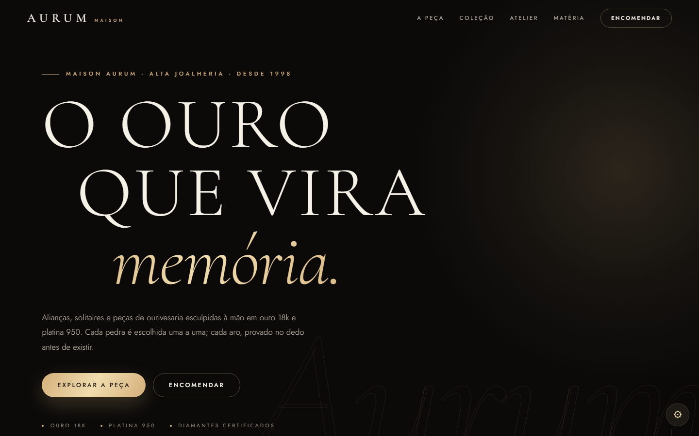
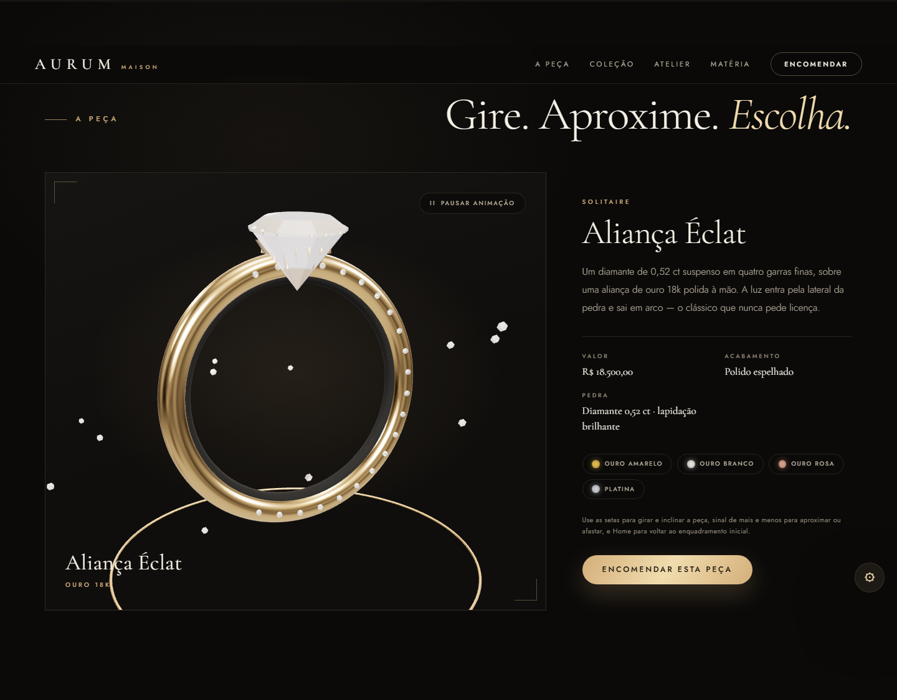
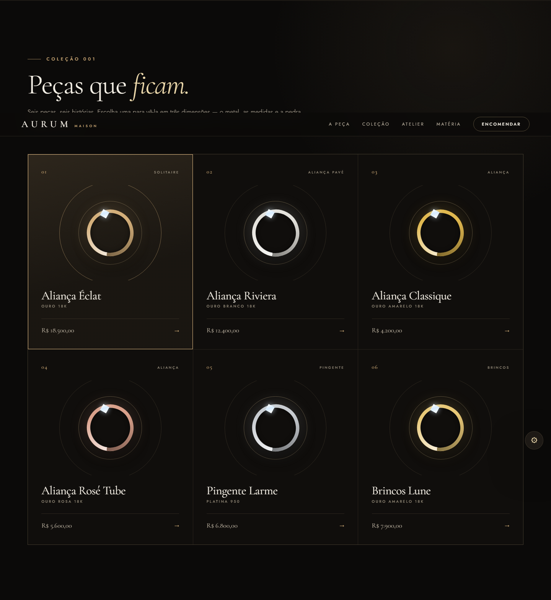
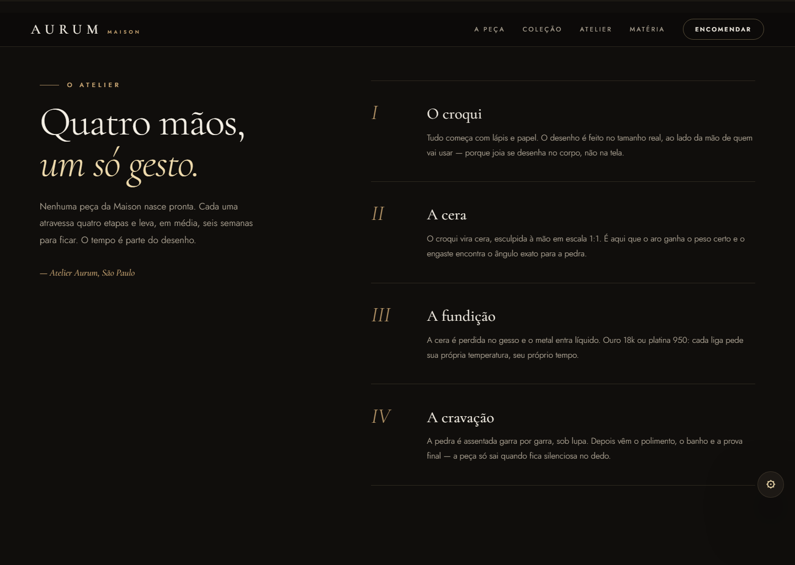
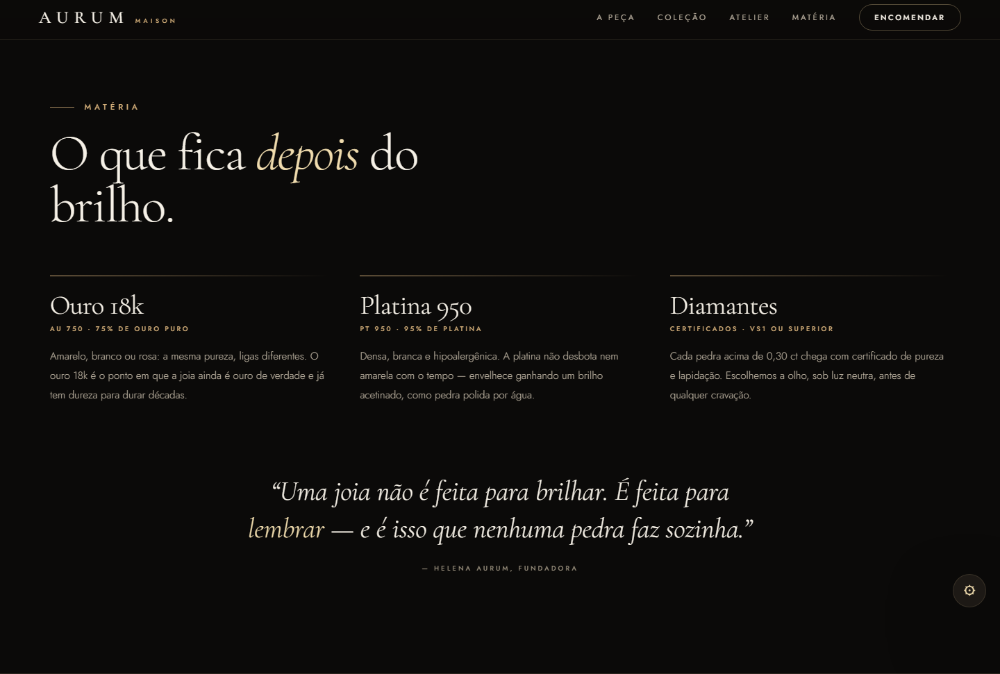
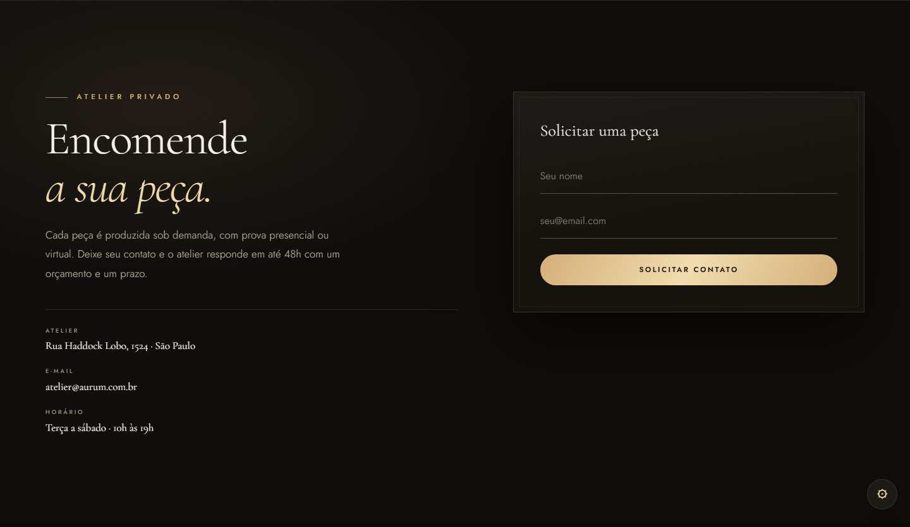

# Aurum — Maison de alta joalheria em Angular + three.js


> Vitrine de alta joalheria: alianças, solitaires e ourivesaria apresentados em uma
> cena 3D real (three.js) sobre ônix, com direção de arte editorial em champanhe e marfim.
> A peça escolhida na galeria troca metal e gema na cena, sem recarregar a página.
>
> **Produção:** https://angular-aurum-3d.vercel.app · **Repo:** privado (`angular-aurum-3d`, branch `main`)

---

## Screenshots do Produto

### Home
| Desktop | Mobile |
|---------|--------|
|  |  |

### Seções
| Cena 3D | Coleção |
|---------|---------|
|  |  |

| Atelier | Matéria |
|---------|---------|
|  |  |

| Encomenda |
|-----------|
|  |

> **Baselines:** regeradas com `npm run e2e:screenshots` (Playwright/Chromium, 1440×900 e
> 390×844) contra o `ng serve` local — rola a página inteira antes da captura para o AOS
> revelar as seções.

---

## Documentação
| Documento | Descrição |
|-----------|-----------|
| [`docs/aurum-3d-case.md`](./docs/aurum-3d-case.md) | Case study: contexto, decisões e o que o projeto demonstra |
| [`docs/clarity-integracao.md`](./docs/clarity-integracao.md) | Integração Microsoft Clarity (mapa de calor), ativa só com `CLARITY_PROJECT_ID` |
| [`docs/manter-online.md`](./docs/manter-online.md) | Estratégia zero-standby / zero cold start |
| [`supabase/README.md`](./supabase/README.md) | Migrations, RLS e seed das tabelas `products` e `leads` |

---

## Setup rápido

```bash
npm install          # postinstall gera src/environments/ambiente.local.ts e instala o Chromium
npm start            # ng serve em http://localhost:4200
```

Sem `VITE_SUPABASE_URL` o app roda em **modo demo**: produtos no mock local e leads no
`localStorage`. O front nunca trava por falta de backend.

Variáveis (`.env`, nunca commitado — copie de [`.env.example`](./.env.example)):

```dotenv
VITE_SUPABASE_URL=
VITE_SUPABASE_ANON_KEY=
VITE_SUPABASE_PROJECT_SLUG=aurum-3d
VITE_ROLE=demo
CLARITY_PROJECT_ID=
BOT_URL=
```

`scripts/gerar-ambiente.mjs` transforma essas variáveis em
`src/environments/ambiente.local.ts` (gitignored) no `postinstall`/`prestart`/`prebuild`/`pretest`.

---

## Comandos principais

| Comando | O que faz |
|---------|-----------|
| `npm start` | Dev server em `http://localhost:4200` |
| `npm run build` | Build de produção em `dist/aurum-3d/browser` |
| `npm run test:ci` | Unitários (Karma/ChromeHeadless) com cobertura |
| `npm run e2e` | Playwright + axe (sobe contra `localhost:4200`) |
| `npm run e2e:ci` | Playwright com reporter HTML (CI) |
| `npm run e2e:screenshots` | Regera as baselines de `docs/screenshots/` |
| `npm run lint` | ESLint + Prettier |
| `npm run analyze` | Build com `stats.json` para inspeção do bundle |
| `npm run env` | Regenera o ambiente a partir do `.env` |

---

## Telas (rotas)

| Rota | Descrição |
|------|-----------|
| `/` | Home única com 7 seções: intro + cena 3D, specs da peça, coleção, atelier, matéria, encomenda e rodapé |
| `/**` | Redireciona para `/` |

Âncoras internas: `#cena`, `#galeria`, `#atelier`, `#materiais`, `#contato`.

---

## Qualidade & Performance

| Métrica | Resultado |
|---------|-----------|
| Testes unitários | 122/122 |
| Cobertura | 93,75% statements · 81,77% branches · 91,48% functions · 97,04% lines |
| Testes E2E | 14/14 |
| Acessibilidade (axe) | 0 violações graves/críticas (WCAG 2.1 AA + best-practice) |
| Build | OK · initial 515,17 kB (139,08 kB transferidos) |
| three.js | chunk lazy de 600,29 kB — fora do bundle inicial |
| AOS | chunk lazy de 14,70 kB |
| Budget | 600 kB initial — o build falha se estourar |

---

## Acessibilidade

- WCAG 2.1 A/AA auditado com `@axe-core/playwright` em três cenários: página, hub aberto e
  registro das violações moderadas.
- **Hub de acessibilidade** no cabeçalho: aumenta/reduz o texto e liga o movimento reduzido,
  anunciando cada mudança em uma região `aria-live`.
- `prefers-reduced-motion`: a cena nasce pausada, o Lenis e o AOS não animam.
- Canvas da cena com `role="img"`, `aria-label` com nome/metal da peça e `tabindex="0"`:
  teclado pausa e retoma o render.
- Galeria como `radiogroup` com *roving tabindex* (setas, Home/End) e anúncio da troca.
- Skip link, foco visível, `lang="pt-BR"` e contraste mínimo de 4,5:1 nos textos fracos.
- O AOS só esconde conteúdo depois de inicializar (`html.aos-pronto`): se o chunk falhar,
  a página continua inteira visível.

---

## Design

- **Conceito:** Maison Aurum — joalheria de autor, não vitrine de e-commerce. A peça é o
  conteúdo; o texto é legenda de editorial de moda.
- **Paleta:** ônix `#0b0a09`, superfície `#16130f`, champanhe `#d4af7a`, champanhe claro
  `#f0dcae`, marfim `#f6f1e7`, texto suave `#bcb2a1`, texto fraco `#9a907e`, esmeralda `#2f6b57`.
- **Tipografia:** Cormorant Garamond (display serif) + Jost (sans, caixa alta espaçada nos rótulos).
- **Movimento:** Lenis para rolagem suave, GSAP ScrollTrigger para o parallax da cena,
  AOS para a revelação dos blocos. Tudo respeita `prefers-reduced-motion`.
- **Cena 3D:** aliança em ouro com aro torneado, cesta de 4 garras e diamante de lapidação
  brilhante (pavilhão, cintura, coroa e mesa) com `transmission`, mais 22 diamantes pavé e
  poeira de luz. Render on demand: ocioso a ~16 fps, interativo frame a frame com OrbitControls.
- **Tema:** escuro por padrão (`data-theme` já preparado para o claro).

---

## Estrutura do projeto

```text
angular-aurum-3d/
├─ e2e/fluxo-principal.spec.ts     # 14 testes Playwright + axe
├─ scripts/gerar-ambiente.mjs      # .env → src/environments/ambiente.local.ts
├─ supabase/                       # migrations, RLS e seed
├─ docs/                           # case study, clarity, manter-online, screenshots/
└─ src/
   ├─ app/
   │  ├─ core/                     # scene (three.js), scroll (Lenis/GSAP/AOS),
   │  │                            # products, lead, accessibility, clarity, anunciador
   │  ├─ layout/                   # header (hub de acessibilidade) e footer
   │  ├─ sections/                 # intro, product-scene, specs, gallery,
   │  │                            # atelier, materiais, lead-capture
   │  └─ pages/home/               # composição da página única
   ├─ environments/                # ambiente.local.ts (gitignored)
   └─ styles.css                   # tokens, tipografia e utilitários
```

---

## Stack

| Camada | Tecnologia |
|--------|------------|
| Framework | Angular 22 (standalone, signals, zoneless, OnPush) |
| 3D | three.js 0.186 + OrbitControls (lazy) |
| Motion | GSAP 3 + ScrollTrigger, Lenis, AOS (lazy) |
| Estilo | Tailwind CSS 4 + CSS custom properties |
| Dados | Supabase (Postgres + RLS), fallback demo em `localStorage` |
| Testes | Karma + Jasmine (unit), Playwright + axe (E2E/a11y) |
| Deploy | Vercel (build estático) |

---

## Decisão de teste: Karma

> three.js/WebGL **exige WebGL real** (contexto de browser) — rodar a cena em `jsdom`/Node
> testa o mock, não o renderer. Karma `ChromeHeadless` é honesto aqui: o mesmo Chrome da CI
> avalia `WebGLRenderer` de verdade, e o teste mede o **render on demand** pela contagem real
> de frames (`cena.contagemRender()`), não por spy.
>
> Trade-offs assumidos: DX mais lenta que Vitest (compila + abre browser) e setup de
> infraestrutura, em troca de fidelidade de integração — exatamente o que o pilar Showcase
> pede. O repositório alterna Vitest/Karma de propósito: agnóstico de ferramenta, decisão
> por problema.
>
> O Playwright cobre o que unitário não alcança: cena montada no DOM real, galeria por mouse
> e teclado, hub de acessibilidade, validação do formulário e auditoria axe. A auditoria espera
> a página assentar (`html.aos-pronto` + 1,4 s) para não acusar contraste falso no meio da
> animação de opacidade do AOS.

---

## O que aprendi

**three.js + Angular com budget apertado**
- `import()` dinâmico mantém o chunk do three (600 kB) **fora do initial bundle**: o inicial
  fica em 515 kB (< 600 kB do budget) e o WebGL só carrega quando a cena monta.
- **Render on demand**: ocioso ~16 fps, interação frame a frame, `IntersectionObserver`
  pausando fora da viewport e pulando frames com a aba oculta.
- `limpar()` com **dispose completo** (geometrias via `traverse`, materiais, controles,
  renderer, listeners) — sem vazamento ao navegar.

**Testar WebGL em Karma (ChromeHeadless)**
- `document.hidden` e o `IntersectionObserver` são armadilhas no headless: canvas fora do DOM
  reporta `isIntersecting: false` e pausa o render. Stubs controláveis tornam o caminho
  determinístico, com fallback `noopCena()` quando o WebGL falha.
- Disputa `afterNextRender` × `DestroyRef` gerava `NG0911 View already destroyed` — guard
  `destruido` + fixture destruída explicitamente resolvem.
- `environment` são data-properties comuns: `spyOnProperty('get')` falha; mutar e restaurar
  no `afterEach` cobre o caminho Supabase sem spy.

**Signals + zoneless**
- A cena é pura via `CenaMontada` (interface): o componente comunica cor e `onPronto` sem
  depender de zone, e a galeria compartilha a seleção pelo signal do `ProductsService`.

**Variáveis de ambiente no Angular 22**
- `import.meta.env` **não funciona** no builder `@angular/build:application`: a substituição
  só existe via `define`, que aceita apenas literais em `angular.json` — o que devolveria a
  chave para dentro do repo. Daí o `scripts/gerar-ambiente.mjs`, que gera
  `src/environments/ambiente.local.ts` (gitignored) antes de `start`/`build`/`test`.
- A tabela `leads` não tinha a coluna `nome` que o formulário enviava — o POST responderia
  400 (`PGRST204`) em produção. A migration adiciona a coluna e a policy de insert fica presa
  ao `project_slug` deste app, para o Supabase compartilhado não misturar as bases.

**Direção de arte em 3D**
- Diamante só "acende" quando a mesa deixa de espelhar a luz de cima: uma inclinação mínima
  do grupo da gema devolve tons diferentes por faceta. Sem isso, a pedra fica um blob branco
  por mais `envMapIntensity` que se adicione.
- Fundo do palco é gradiente CSS com canvas transparente — o pedestal sólido pesava a
  composição e escondia o brilho do aro de ouro no chão.

---

## Branches & Workflow Git

```text
main      → produção (build estático; nunca push direto)
homolog   → validação/release de PRs (staging)
develop   → integração diária (merges das branches feat/*)
feat/*    → assunto em Conventional Commits, PR para develop
```

- **Commits:** `feat:`, `fix:`, `test:`, `docs:`, `design:`, `ops:`, `backend:`
- **PRs:** sempre via pull request template, revisados e mergeados por milestone
- **main:** protegida — merge somente via PR de `homolog`
- CI em `.github/workflows/ci.yaml` (build + unit + E2E), além dos bots de análise,
  testes e uptime.

---

## Deploy

- **Vercel**, build estático (`npm run build`, saída `dist/aurum-3d/browser`).
- `vercel.json` define o rewrite SPA, cache imutável para `/assets/(.*)` e `*.js`.
- Variáveis de ambiente no painel do Vercel: as mesmas do `.env` (`VITE_*` e `CLARITY_PROJECT_ID`).
- Sem `VITE_SUPABASE_URL` em produção o site sobe em modo demo — nunca quebra, só não persiste.

---

## Links

- Produção: https://angular-aurum-3d.vercel.app
- Repositório: privado (`zecki1/angular-aurum-3d`)
- Autor: [@zecki1](https://github.com/zecki1)

---

## Licença

Projeto de portfólio — uso pessoal. Todos os direitos reservados.
