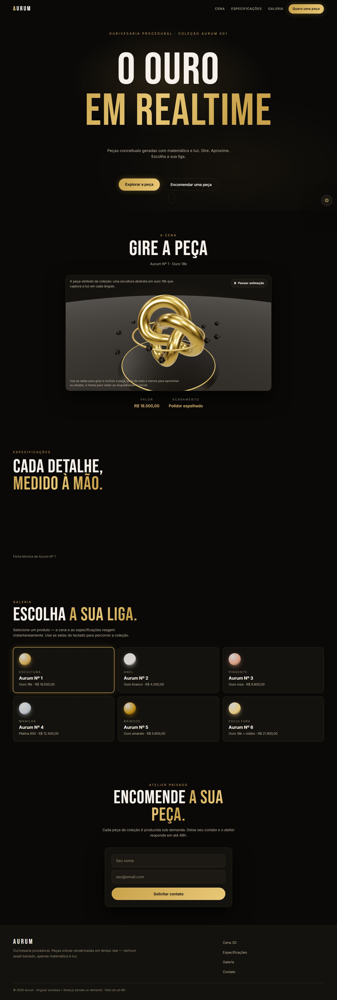
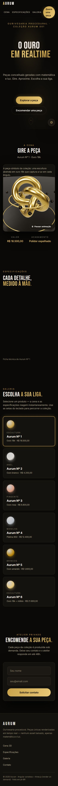
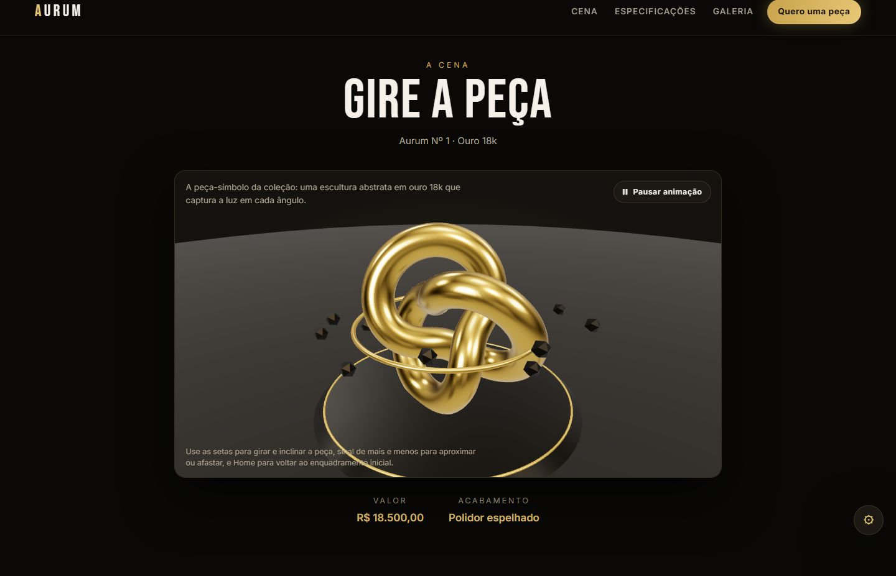
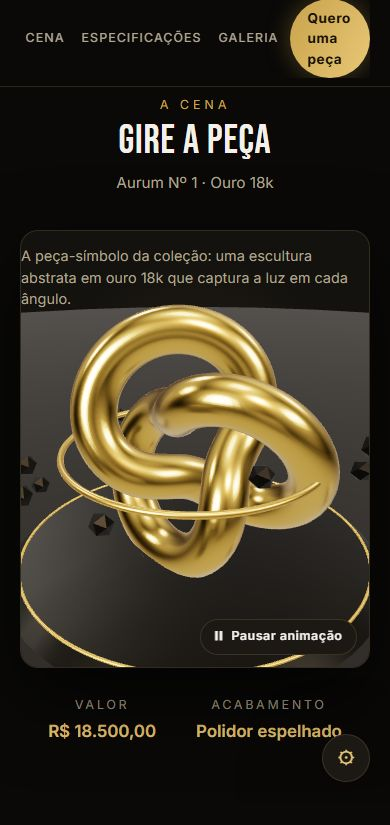
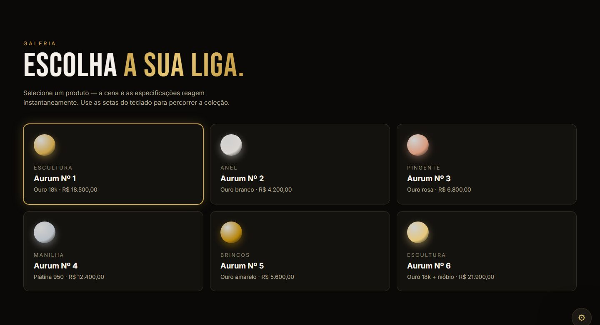
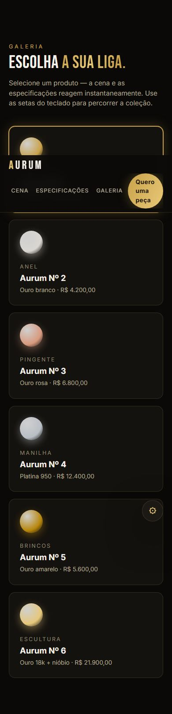
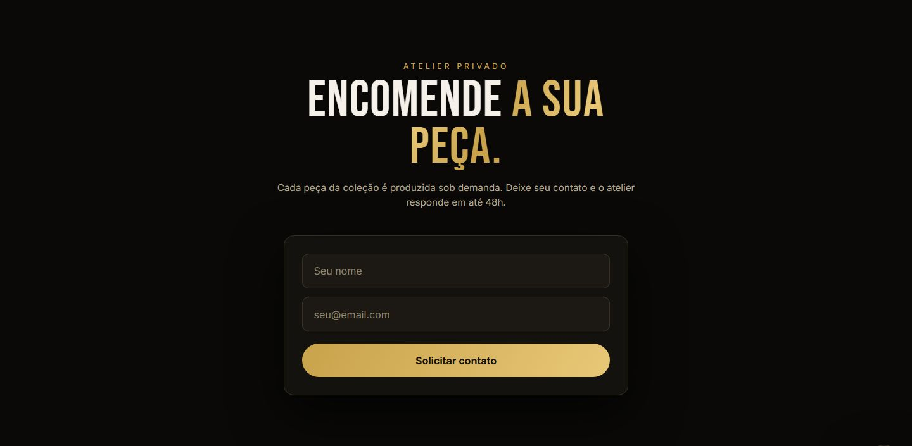
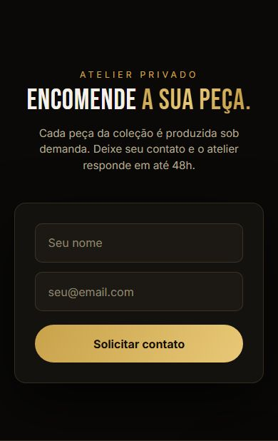

# Aurum — Ourivesaria 3D Interativa


> Showcase 3D de uma ourivesaria fictícia: a peça é inspecionável antes de qualquer preço aparecer.
> Cena three.js com **render on demand** dentro do orçamento de bundle do Angular 22.
> Pilar **Showcase** · Semana 5 · Milestone `m1-aurum` · Demo pública no GitHub Pages.

---

## Screenshots do Produto

### Home (intro + cena 3D + ficha técnica + galeria + contato)
| Desktop | Mobile |
|---------|--------|
|  |  |

### Cena 3D (`#cena`)
| Desktop | Mobile |
|---------|--------|
|  |  |

### Galeria (`#galeria`)
| Desktop | Mobile |
|---------|--------|
|  |  |

### Contato (`#contato`)
| Desktop | Mobile |
|---------|--------|
|  |  |

> **Baselines:** 8 screenshots (4 recortes × desktop/mobile) versionadas em `docs/screenshots/`,
> geradas por `e2e/screenshots.spec.ts` (Playwright/Chromium real). Regerar com `npm run e2e:screenshots`.

---

## Documentação

| Arquivo | Descrição |
|---------|-----------|
| [`docs/aurum-3d-case.md`](./docs/aurum-3d-case.md) | Case study: contexto, desafio, solução, métricas e "o que aprendi" |
| [`docs/a11y/relatorio-axe.json`](./docs/a11y/relatorio-axe.json) | Relatório de acessibilidade (axe) da home e do hub aberto |
| [`docs/clarity-integracao.md`](./docs/clarity-integracao.md) | Integração do Microsoft Clarity (mapa de calor) |
| [`docs/manter-online.md`](./docs/manter-online.md) | Estratégia zero-standby (custo zero) |
| [`supabase/README.md`](./supabase/README.md) | Migrations, RLS e seed de `products` + `leads` |

---

## Setup Rápido

```bash
npm install          # instala dependências + gera src/environments/ambiente.local.ts no postinstall
npm start            # ng serve → http://localhost:4200
```

O app funciona **sem backend**: sem `VITE_SUPABASE_URL` ele roda em **modo demo** — os seis produtos
vêm de um mock local e os leads caem no `localStorage`. O front nunca trava por falta de credencial.

---

## Comandos Principais

| Comando | Descrição |
|---------|-----------|
| `npm start` | Servidor de desenvolvimento (`ng serve`) |
| `npm run build` | Build de produção (`ng build`) |
| `npm run lint` | ESLint + angular-eslint |
| `npm test` | Testes unitários (Karma, watch) |
| `npm run test:ci` | Testes unitários + cobertura (CI) |
| `npm run e2e` | Playwright completo (fluxo + axe + screenshots) |
| `npm run e2e:ci` | Playwright com relatório HTML (CI) |
| `npm run e2e:a11y` | Varredura de acessibilidade (gera `docs/a11y/relatorio-axe.json`) |
| `npm run e2e:screenshots` | Regenera os prints do README |
| `npm run analyze` | Análise de bundle (`ng build --stats-json`) |
| `npm run env` | Regenera o ambiente a partir do `.env` |

---

## Telas Implementadas

O app é uma **página única** (rotas `''` e `'**'`) — a narrativa inteira vive na home e as seções
são navegáveis por âncora.

| Seção | Rota/âncora | Conteúdo |
|-------|-------------|----------|
| Intro | `/` | Hero editorial com título "O OURO EM REALTIME" e CTAs para a cena e o contato |
| Cena 3D | `/#cena` | `three.js` procedural (6 peças), PBR, ÓrbitControls e botão de pausa — operável por teclado |
| Ficha técnica | `/#specs` | Especificações da peça selecionada, com reveal animado no scroll |
| Galeria | `/#galeria` | `radiogroup` das seis ligas com roving tabindex (setas/Home/End) |
| Contato | `/#contato` | Formulário de lead validado → Supabase `leads` com fallback demo |

---

## Qualidade & Performance

| Métrica | Resultado |
|---------|-----------|
| **Unit tests (Karma/ChromeHeadless)** | 122/122 passando |
| **Cobertura** | 95,26% statements · 85,71% branches · 93,02% functions · 98,27% lines |
| **E2E (Playwright)** | 23/23 passando (fluxo principal + axe + screenshots) |
| **Acessibilidade (axe)** | 0 violações (home e hub aberto) |
| **Lighthouse (mobile, headless)** | Performance **55** · A11y **100** · Best Practices **96** · SEO **100** |
| **ESLint** | 0 erros · 0 warnings |
| **Bundle inicial** | 445,52 kB raw (≈127,50 kB transfer) — budget 500 kB |
| **Chunk lazy three.js** | 596,98 kB, baixado só quando a cena monta |
| **Responsivo** | mobile (390) / desktop (1440) |

> Performance 55 é trade-off consciente — medido em **mobile simulado** com cache frio: TBT de ~5,3 s vem
> de compilar shaders/rodar a cena na CPU do dispositivo emulado. O que dá para otimizar sem cortar a
> assinatura 3D já está feito: three.js é chunk **sob demanda** (fora do initial bundle),
> render on demand com pausa fora da viewport, `dpr` limitado a 2 e CLS 0,01. Otimização agressiva
> fica para a fase de performance do roadmap.

---

## Acessibilidade

Varredura automatizada com `@axe-core/playwright` (tags WCAG 2.0/2.1 A+AA) — **zero violações**
na home e com o hub de acessibilidade aberto (27 e 28 regras aprovadas).

- O `<canvas>` é `role="img"` com `aria-label` descritivo, `tabindex="0"` e `aria-describedby` para as
  instruções; setas giram/inclinam, `+`/`-` dão zoom e `Home` reenquadra — **a cena é operável sem mouse**.
- WCAG 2.2.2: a cena nasce **pausada** com `prefers-reduced-motion: reduce` e há botão de pausa com
  `aria-pressed`.
- A galeria é um `radiogroup` com roving tabindex (um item tabulável) e anuncia a troca via `aria-live`.
- Formulário com `aria-invalid` + `aria-describedby` ligando erro e campo; sucesso recebe foco e é anunciado.
- Contraste medido nos tokens (`--texto-fraco` foi ajustado para passar de 4,5:1).
- Relatório versionado em [`docs/a11y/relatorio-axe.json`](./docs/a11y/relatorio-axe.json).
  Reproduzir: `npm run e2e:a11y`.

---

## Design — decisão e intenção

> Cada escolha abaixo tem um "para quê" — nada é decorativo solto.

### Conceito

**Aurum** é uma ourivesaria fictícia que vende **seis peças em ouro** geradas proceduralmente. O site
se comporta como uma vitrine de joalheria: preto profundo, luz dourada e a peça como protagonista. O
briefing era claro — *a peça precisa ser inspecionável antes de qualquer preço aparecer*. Nada de card
de e-commerce; o produto é um objeto de valor que se gira com a mão e com o teclado.

### Identidade visual

| Token | Valor | Para quê |
|-------|-------|----------|
| `--fundo` `#0a0908` / `--superficie` `#14120f` | preto profundo | Palco escuro de joalheria — faz o dourado brilhar |
| `--texto` `#f5f1ea` | off-white quente | Leitura confortável sobre o preto (tom de papel, não branco puro) |
| `--dourado` `#c9a24b` / `--dourado-forte` `#e8c877` | ouro | Ação, destaque e a própria liga das peças — o ouro é o dado e o acento |
| `--borda` `rgba(218,185,120,.16)` | filete de ouro translúcido | Separa seções sem gritar |
| `--cor-erro` `#ff6f61` / `--cor-sucesso` `#7fd8a4` | coral / verde | Estados do formulário, na mesma temperatura da paleta |

- **Tipografia:** `Bebas Neue` (display) para títulos em caixa alta e `Inter` (corpo). O contraste entre
  o título condensado gigante e o corpo sóbrio é a hierarquia — sem precisar de mais peso.
- **Formas e luz:** cards com filete dourado, `--brilho` (sombra profunda) para dar volume e o glow do
  intro como fonte de luz da cena. `:target`/`section[id]` ganham `scroll-margin-top` por causa do
  header fixo.

### Estratégia de movimento

| Peça | Implementação | Intenção |
|------|---------------|----------|
| Cena 3D | three.js com `import()` dinâmico, `RoomEnvironment` + materiais PBR | A peça responde à luz real do ambiente — brilho de metal, não textura pintada |
| Render on demand | Um único `requestAnimationFrame`; ocioso ~16 fps; `IntersectionObserver` pausa fora da viewport e a aba oculta pula frames | Gastar GPU só quando há algo a mostrar |
| Reveal das specs | Diretiva `appSpecReveal` (GSAP) com `prefers-reduced-motion` | A ficha "se monta" conforme o visitante rola — dá tempo de ler |
| Controles | Botão de pausa, setas/`+`/`-`/`Home`, `aria-label` vivo com a peça atual | A "inspeção" não pode depender do mouse |

### Trade-off consciente

O three.js custa ~597 kB e compilar shaders custa caro em CPU mobile (Lighthouse Performance 55). A
resposta não foi cortar a cena — foi **isolar o custo**: chunk sob demanda (initial dentro do budget),
render on demand e pausa automática. A meta de perf ≥ 90 fica para a fase de performance do roadmap.

---

## Estrutura do Projeto

```text
src/
├─ app/
│  ├─ components/           # accessibility-hub (diálogo de acessibilidade)
│  ├─ core/                 # services (scene, products, leads, clarity, anúncio) + diretivas
│  ├─ layout/               # header fixo + footer
│  ├─ pages/home/           # única página — compõe as seções
│  └─ sections/             # intro, product-scene, specs, gallery, lead-capture
├─ environments/
└─ index.html
e2e/                        # Playwright: fluxo principal, acessibilidade (axe), screenshots
docs/                       # case study, a11y, screenshots, runbooks
bot(s)/                     # bots de navegação humana e análise de erros
supabase/                   # migrations, RLS e seed de products + leads
.github/workflows/          # CI (lint→build→unit→e2e→lighthouse) + Deploy (GitHub Pages)
```

---

## Stack

| Responsabilidade | Tecnologia |
|------------------|------------|
| Framework | Angular 22 (standalone, signals, zoneless, OnPush) |
| Linguagem | TypeScript |
| Estilização | Tailwind CSS 4 + tokens CSS próprios |
| 3D | three.js (chunk lazy, PBR, RoomEnvironment, OrbitControls) |
| Animação | GSAP (reveal das seções) |
| Backend/Dados | Supabase (Postgres + RLS) · mock local em modo demo |
| Testes | Karma/Jasmine (unit) · Playwright + axe (E2E/a11y) |
| Qualidade | ESLint + angular-eslint · Lighthouse CI |
| Deploy | GitHub Pages (site estático) |

---

## Branches & Workflow Git

```text
main      → produção (build estático; push dispara deploy no GitHub Pages)
homolog   → validação/release de PRs (staging)
develop   → integração diária (merges das feat/*)
feature   → feat/<assunto> + PR para develop
```

- **Commits:** `feat:`, `fix:`, `test:`, `docs:`, `design:`, `ops:`, `backend:` (Conventional Commits)
- **PRs:** via pull request template; revisados e mergeados por milestone
- **main:** protegida — merge somente via PR
- Rastreabilidade com issues, labels (`feat/test/design/ops/backend`) e milestones

---

## Bots (estação local + CI)

Os bots vivem em `bots/` e rodam localmente e no GitHub Actions. Cada um olha uma dimensão que o outro não enxerga.

| Bot | O que faz | Como roda localmente |
|-----|-----------|----------------------|
| **Humano** (`bots/humano/navegacao-humana.mjs`) | Navega com comportamento de pessoa real (cliques com atraso, scroll gradual, hesitação). Detecta travamento, loop de animação e navegação quebrada. | `BOT_URL=http://localhost:4200 node bots/humano/navegacao-humana.mjs` |
| **Analisador de erros** (`bots/analise-erros/analisador.mjs`) | Lê logs de build/e2e/CI, classifica por severidade e aponta padrões repetidos. | `node bots/analise-erros/analisador.mjs` |
| **CI + Lighthouse** | `npm ci` → lint → build → Karma (coverage) → Playwright + axe → Lighthouse. | `npm run build` + `npx lhci autorun` |

---

## Microsoft Clarity (mapa de calor)

Integração **condicional**: o snippet só é injetado quando `CLARITY_PROJECT_ID` está definido no ambiente.
Grava mapa de calor, scroll, cliques e sessões reais — a "comunicação" que fecha o ciclo dos bots.
Ver [`docs/clarity-integracao.md`](./docs/clarity-integracao.md).

---

## Deploy

- **GitHub Pages** (projeto público): `https://zecki1.github.io/angular-aurum-3d/`
  Workflow [`.github/workflows/deploy-pages.yaml`](./.github/workflows/deploy-pages.yaml) — build com
  `--base-href=/angular-aurum-3d/` + fallback SPA (`index.html` → `404.html`) + `.nojekyll`.
- **Política do workspace:** projetos públicos → GitHub Pages; projetos privados → Vercel
  (config em `vercel.json`, apontando para `dist/aurum-3d/browser`).
- Estratégia zero-standby documentada em [`docs/manter-online.md`](./docs/manter-online.md).

---

## Links Úteis

- **Produção (GitHub Pages):** https://zecki1.github.io/angular-aurum-3d/
- **Repositório:** https://github.com/zecki1/angular-aurum-3d
- **Case study:** [`docs/aurum-3d-case.md`](./docs/aurum-3d-case.md)

---

## Licença

MIT — ver [`LICENSE`](./LICENSE).
